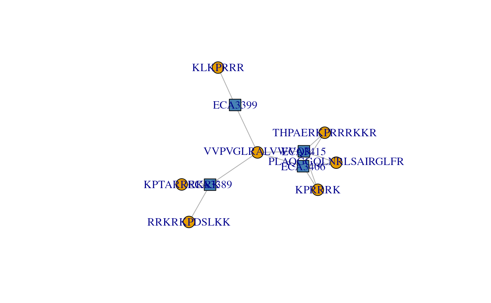
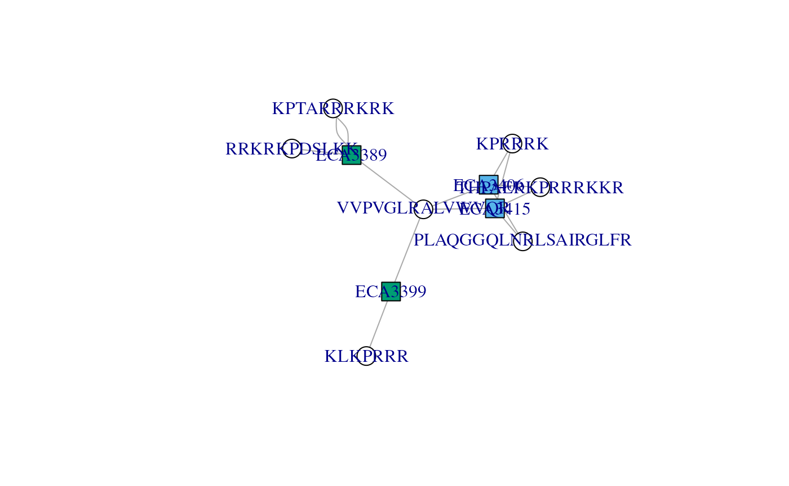
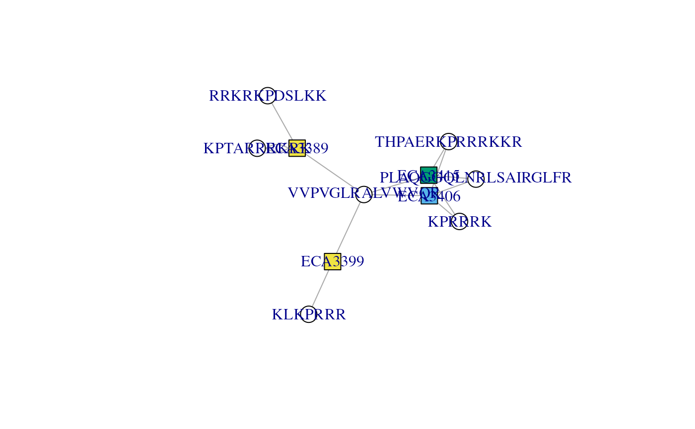
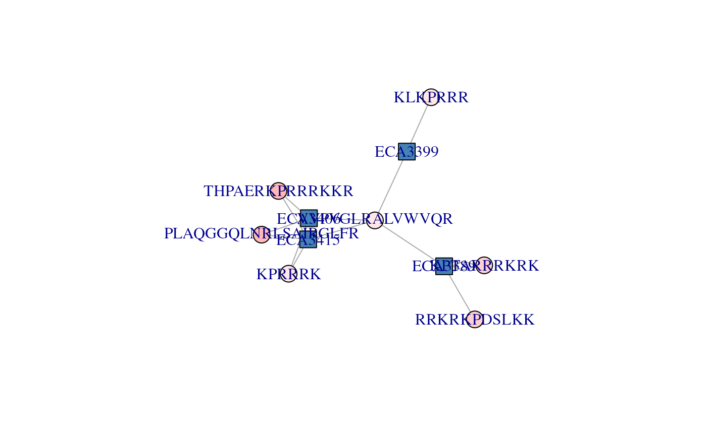
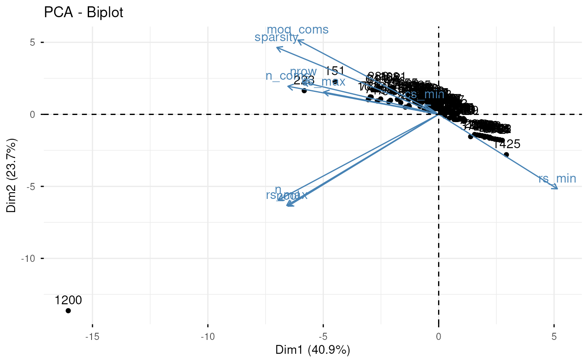

# Understanding protein groups with adjacency matrices

**Package**:
*[PSMatch](https://bioconductor.org/packages/3.24/PSMatch)*\
**Authors**: Laurent Gatto \[aut, cre\] (ORCID:
<https://orcid.org/0000-0002-1520-2268>), Johannes Rainer \[aut\]
(ORCID: <https://orcid.org/0000-0002-6977-7147>), Sebastian Gibb \[aut\]
(ORCID: <https://orcid.org/0000-0001-7406-4443>), Samuel Wieczorek
\[ctb\], Thomas Burger \[ctb\], Guillaume Deflandre \[aut\] (ORCID:
<https://orcid.org/0009-0008-1257-2416>)\
**Last modified:** 2026-11-13 22:25:22.290796\
**Compiled**: Fri Nov 13 22:41:10 2026

## Introduction

This vignette is one among several illustrating how to use the `PSMatch`
package, focusing on the modelling peptide-protein relations using
adjacency matrices and connected components. For a general overview of
the package, see the `PSMatch` package manual page
([`?PSMatch`](https://rformassspectrometry.github.io/PSMatch/reference/PSMatch.md))
and references therein.

## Peptide-protein relation

Let’s start by loading and filter PSM data as illustrated in the
[*Working with PSM
data*](https://rformassspectrometry.github.io/PSMatch/articles/PSM.html)
vignette.

\
[`library`](https://rdrr.io/r/base/library.html)`(`[`"PSMatch"`](https://github.com/RforMassSpectrometry/PSMatch)`)`\
`id`` ``<-`` ``MsDataHub``::`[`TMT_Erwinia_1uLSike_Top10HCD_isol2_45stepped_60min_01.20141210.mzid`](https://rformassspectrometry.github.io/MsDataHub/reference/PXD000001.html)`(``)`` ``|>`\
`    `[`PSM`](https://rformassspectrometry.github.io/PSMatch/reference/PSM.md)`(``)`` ``|>`\
`    `[`filterPsmDecoy`](https://rformassspectrometry.github.io/PSMatch/reference/filterPSMs.md)`(``)`` ``|>`\
`    `[`filterPsmRank`](https://rformassspectrometry.github.io/PSMatch/reference/filterPSMs.md)`(``)`

    ## Warning: replacing previous import 'BiocGenerics::version' by
    ## 'BiocManager::version' when loading 'AnnotationHub'

    ## see ?MsDataHub and browseVignettes('MsDataHub') for documentation

    ## loading from cache

    ## Loading required namespace: mzR

    ## Removed 2896 decoy hits.

    ## Removed 155 PSMs with rank > 1.

\
`id`

    ## PSM with 2751 rows and 35 columns.
    ## names(35): sequence spectrumID ... subReplacementResidue subLocation

When identification data is stored as a table, the relation between
peptides is typically encoded in two columns, once containing the
peptide sequences and the second the protein identifiers these peptides
stem from. Below are the 10 first observations of our identification
data table.

\
[`data.frame`](https://rdrr.io/r/base/data.frame.html)`(``id``[``1``:``10``, `[`c`](https://rdrr.io/r/base/c.html)`(``"sequence"``, ``"DatabaseAccess"``)``]``)`

    ##                                    sequence DatabaseAccess
    ## EH7807.1                       RQCRTDFLNYLR        ECA2006
    ## EH7807.2             ESVALADQVTCVDWRNRKATKK        ECA1676
    ## EH7807.4             QRMARTSDKQQSIRFLERLCGR        ECA3009
    ## EH7807.6          DGGPAIYGHERVGRNAKKFKCLKFR        ECA1420
    ## EH7807.7             QRMARTSDKQQSIRFLERLCGR        ECA3009
    ## EH7807.8  CIDRARHVEVQIFGDGKGRVVALGERDCSLQRR        ECA2142
    ## EH7807.9  CIDRARHVEVQIFGDGKGRVVALGERDCSLQRR        ECA2142
    ## EH7807.10              VGRCRPIINYLASPGGTSER        ECA0331
    ## EH7807.16               QRLDEHCVGVGQNALLLGR        ECA3680
    ## EH7807.17  VDYQGKKVVIIGLGLTGLSCVDFFLARGVVPR        ECA3817

This information can however also be encoded as an adjacency matrix with
peptides along the rows and proteins along the columns, and a 1 (or more
generally a value \> 0) indicating that a peptides belongs to the
corresponding proteins. Such a matrix is created below for our
identification data.

\
`adj`` ``<-`` `[`makeAdjacencyMatrix`](https://rformassspectrometry.github.io/PSMatch/reference/adjacencyMatrix.md)`(``id``)`\
[`dim`](https://rdrr.io/r/base/dim.html)`(``adj``)`

    ## [1] 2357 1504

\
`adj``[``1``:``5``, ``1``:``5``]`

    ## 5 x 5 sparse Matrix of class "dgCMatrix"
    ##                                   ECA2006 ECA1676 ECA3009 ECA1420 ECA2142
    ## RQCRTDFLNYLR                            1       .       .       .       .
    ## ESVALADQVTCVDWRNRKATKK                  .       1       .       .       .
    ## QRMARTSDKQQSIRFLERLCGR                  .       .       2       .       .
    ## DGGPAIYGHERVGRNAKKFKCLKFR               .       .       .       1       .
    ## CIDRARHVEVQIFGDGKGRVVALGERDCSLQRR       .       .       .       .       2

This matrix models the relation between the 2357 peptides and the 1504
is our identification data. These numbers can be verified by checking
the number of unique peptides sequences and database accession numbers.
For the latter, if the peptide stems from multiple proteins, these
proteins are separated by default with a semicolon `;`.

\
[`length`](https://rdrr.io/r/base/length.html)`(`[`unique`](https://rdrr.io/r/base/unique.html)`(``id``$``sequence``)``)`

    ## [1] 2357

\
[`length`](https://rdrr.io/r/base/length.html)`(`[`unique`](https://rdrr.io/r/base/unique.html)`(`[`unlist`](https://rdrr.io/r/base/unlist.html)`(`[`strsplit`](https://rdrr.io/r/base/strsplit.html)`(``id``$``DatabaseAccess``, ``";"``)``)``)``)`

    ## [1] 1504

Some values are \> 1 because some peptide sequences are observed more
than once, for example carrying different modifications or the same one
at different sites or having different precursor charge states. The
adjacency matrix can be made binary by setting
`madeAdjacencyMatrix(id, binary = TRUE)`.

This large matrix is too large to be explored manually and is anyway not
interesting on its own. Subsets of this matrix that define proteins
defined by a set of peptides (whether shared or unique) is relevant.
These are represented by subsets of this large matrix named connected
component. We can easily compute all these connected components to
produce the multiple smaller and relevant adjacency matrices.

\
`cc`` ``<-`` `[`ConnectedComponents`](https://rformassspectrometry.github.io/PSMatch/reference/ConnectedComponents.md)`(``adj``)`\
[`length`](https://rdrr.io/r/base/length.html)`(``cc``)`

    ## [1] 1476

\
`cc`

    ## An instance of class ConnectedComponents 
    ##  Number of proteins: 1504 
    ##  Number of components: 1476 
    ##  Number of components [peptide x proteins]:
    ##   954[1 x 1] 7[1 x n] 501[n x 1] 14[n x n]

Among the 2357 and the 1504 proteins, we have 1476 connected components.

954 thereof, such as the one shown below, correspond to single proteins
identified by a single peptide:

\
[`connectedComponents`](https://rformassspectrometry.github.io/PSMatch/reference/ConnectedComponents.md)`(``cc``, ``1``)`

    ## 1 x 1 sparse Matrix of class "dgCMatrix"
    ##                        ECA0003
    ## KTLGAYDFSFGEGIYTHMKALR       1

7 thereof represent protein groups identified by a single shared
peptide:

\
[`connectedComponents`](https://rformassspectrometry.github.io/PSMatch/reference/ConnectedComponents.md)`(``cc``, ``527``)`

    ## 1 x 2 sparse Matrix of class "dgCMatrix"
    ##            ECA1637 ECA2914
    ## KEIILNKNEK       1       1

501 represent single proteins identified by multiple unique peptides:

\
[`connectedComponents`](https://rformassspectrometry.github.io/PSMatch/reference/ConnectedComponents.md)`(``cc``, ``38``)`

    ## 5 x 1 sparse Matrix of class "dgCMatrix"
    ##                               ECA0130
    ## GKIECNLRFELDPSAQSALILNEKLAK         1
    ## ERLQSKLEDAQVQLENNRLEQELVLMAQR       1
    ## GNWGSAAWELRSVNQR                    1
    ## ILKKEEAVGRR                         1
    ## ERIRARLTR                           1

Finally, arguable those that warrant additional exploration are those
that are composed of multiple peptides and multiple proteins. There are
14 thereof in this identification; here’s an example:

\
[`connectedComponents`](https://rformassspectrometry.github.io/PSMatch/reference/ConnectedComponents.md)`(``cc``, ``920``)`

    ## 4 x 2 sparse Matrix of class "dgCMatrix"
    ##                    ECA2869 ECA4278
    ## QKTRCATRAFKANKGRAR       1       1
    ## IDFLRDPKGYLR             1       .
    ## RFKQKTR                  .       1
    ## LIRKQVVQPGYR             1       1

## Visualising adjacency matrices

Let’s identify the connected components that have at least 3 peptides
(i.e. rows in the adjacency matrix) and 3 proteins (i.e. columns in the
adjacency matrix).

\
`(``i`` ``<-`` `[`which`](https://rdrr.io/r/base/which.html)`(``nrows``(``cc``)`` ``>`` ``2`` ``&`` ``ncols``(``cc``)`` ``>`` ``2``)``)`

    ## [1] 1079 1082

\
`dims``(``cc``)``[``i``, ``]`

    ##      nrow ncol
    ## [1,]    3    4
    ## [2,]    7    4

We will use the second adjacency matrix, with index 1082 to learn about
the
[`plotAdjacencyMatrix()`](https://rformassspectrometry.github.io/PSMatch/reference/adjacencyMatrix.md)
function and explore how to inform our peptides filtering beyond the
`filterPsm*()` functions.

\
`cx`` ``<-`` `[`connectedComponents`](https://rformassspectrometry.github.io/PSMatch/reference/ConnectedComponents.md)`(``cc``, ``1082``)`\
`cx`

    ## 7 x 4 sparse Matrix of class "dgCMatrix"
    ##                     ECA3406 ECA3415 ECA3389 ECA3399
    ## THPAERKPRRRKKR            1       1       .       .
    ## KPTARRRKRK                .       .       2       .
    ## PLAQGGQLNRLSAIRGLFR       1       1       .       .
    ## RRKRKPDSLKK               .       .       1       .
    ## KPRRRK                    1       1       .       .
    ## VVPVGLRALVWVQR            1       1       1       1
    ## KLKPRRR                   .       .       .       1

We can now visualise the the `cx` adjacency matrix with the
[`plotAdjacencyMatrix()`](https://rformassspectrometry.github.io/PSMatch/reference/adjacencyMatrix.md)
function. The nodes of the graph represent proteins and petides - by
default, proteins are shown as blue squares and peptides as white
circles. Edge connect peptides/circles to proteins/squares, indicating
that a peptide belongs to a protein.

\
[`plotAdjacencyMatrix`](https://rformassspectrometry.github.io/PSMatch/reference/adjacencyMatrix.md)`(``cx``)`

    ## Warning: vertex attribute color contains NAs. Replacing with default value 1
    ## vertex attribute color contains NAs. Replacing with default value 1
    ## vertex attribute color contains NAs. Replacing with default value 1
    ## vertex attribute color contains NAs. Replacing with default value 1
    ## vertex attribute color contains NAs. Replacing with default value 1
    ## vertex attribute color contains NAs. Replacing with default value 1
    ## vertex attribute color contains NAs. Replacing with default value 1
    ## vertex attribute color contains NAs. Replacing with default value 1
    ## vertex attribute color contains NAs. Replacing with default value 1
    ## vertex attribute color contains NAs. Replacing with default value 1
    ## vertex attribute color contains NAs. Replacing with default value 1

We can immediately observe that peptide `VVPVGLRALVWVQR` is associated
to all four proteins; it holds that protein group together, defines that
connected component formed by these four proteins. If we were to drop
that peptides, we would obtain two single proteins, `ECA3399` (defined
by `KLKPRRR`), `ECA3398` (defined by `RRKRKPDSLKK` and `KPTARRRKRK`) and
a protein group formed of `ECA3415` and `ECA3406` (defined by three
shared peptides).

### Colouring the graph nodes

To help with the interpretation of the graph and the potential benefits
of additional manual peptide filtering, it is possible to customise the
node colours. Protein and peptide node colours can be controlled with
the `protColors` and `pepColors` arguments respectively. Let’s start
with the former.

#### Colouring protein nodes

`protColors` can either be a numeric or a character. The default value
is 0, which produces the figure above. Any value \> 0 will lead to more
proteins being highlighted using different colours. Internally, string
distances between protein names are computed and define if proteins
should be coded with the same colours (if they are separated by small
distances, i.e. they have similar names) or different colours (large
distance, dissimilar names).

By setting the argument to 1, we see that proteins starting with `ECA33`
and those starting with `ECA34` are represented with different colours.

\
[`plotAdjacencyMatrix`](https://rformassspectrometry.github.io/PSMatch/reference/adjacencyMatrix.md)`(``cx``, ``1``)`

We can further distinguish `ECA3406`, and `ECA314` and `ECA33*9` by
setting `protColors` to 2.

\
[`plotAdjacencyMatrix`](https://rformassspectrometry.github.io/PSMatch/reference/adjacencyMatrix.md)`(``cx``, ``2``)`

`protColors` can also be a character of colours named by protein names.
We will illustrate this use below, as it functions the same way as
`pepColors`.

#### Colouring peptide nodes

`pepColors` can either be `NULL` to represent peptides as white nodes
(as we have seen in all examples above). Alternatively, it can be set to
a character of colours names after the peptides sequences. Let’s use the
search engine score (here `MS.GF.RawScore`) to annotate the peptide
nodes.

We can extract this metric from the PSM object we started with and
create a colour palette representing the range of scores.

The named vector of scores:

\
`score`` ``<-`` ``id``$``MS.GF.RawScore`\
[`names`](https://rdrr.io/r/base/names.html)`(``score``)`` ``<-`` ``id``$``sequence`\
[`head`](https://rdrr.io/r/utils/head.html)`(``score``)`

    ##                      RQCRTDFLNYLR            ESVALADQVTCVDWRNRKATKK 
    ##                                10                                12 
    ##            QRMARTSDKQQSIRFLERLCGR         DGGPAIYGHERVGRNAKKFKCLKFR 
    ##                                -5                                 7 
    ##            QRMARTSDKQQSIRFLERLCGR CIDRARHVEVQIFGDGKGRVVALGERDCSLQRR 
    ##                                21                               -31

The matching named vector of colours:

\
`cls`` ``<-`` `[`as.character`](https://rdrr.io/r/base/character.html)`(`[`cut`](https://rdrr.io/r/base/cut.html)`(``score``, ``12``,`\
`                        labels ``=`` `[`colorRampPalette`](https://rdrr.io/r/grDevices/colorRamp.html)`(`[`c`](https://rdrr.io/r/base/c.html)`(``"white"``, ``"red"``)``)``(``12``)``)``)`\
[`names`](https://rdrr.io/r/base/names.html)`(``cls``)`` ``<-`` ``id``$``sequence`\
[`head`](https://rdrr.io/r/utils/head.html)`(``cls``)`

    ##                      RQCRTDFLNYLR            ESVALADQVTCVDWRNRKATKK 
    ##                         "#FFA2A2"                         "#FFA2A2" 
    ##            QRMARTSDKQQSIRFLERLCGR         DGGPAIYGHERVGRNAKKFKCLKFR 
    ##                         "#FFB9B9"                         "#FFA2A2" 
    ##            QRMARTSDKQQSIRFLERLCGR CIDRARHVEVQIFGDGKGRVVALGERDCSLQRR 
    ##                         "#FFA2A2"                         "#FFD0D0"

Below, we see that all these peptides have relatively low scores (light
red), and that two of the three of the `ECA34*` proteins have the
highest scores.

\
[`plotAdjacencyMatrix`](https://rformassspectrometry.github.io/PSMatch/reference/adjacencyMatrix.md)`(``cx``, pepColors ``=`` ``cls``)`

## Using quantitative data

To conclude this vignette, we show how this same data modelling and
exploration can be initiated from a quantitative dataset. We will use
part of the CPTAC data that is available in the `MsDataHub` package.

Once we have the path to the tsv data, we identify the columns that
contain quantitation values (i.e. those starting with `Intensity.`) and
them create a `SummarizedExperiment` using the
[readSummarizedExperiment()](https://rformassspectrometry.github.io/QFeatures/reference/readQFeatures.html)
function from the
*[QFeatures](https://bioconductor.org/packages/3.24/QFeatures)* package.

\
`f`` ``<-`` ``MsDataHub``::`[`cptac_a_b_peptides.txt`](https://rformassspectrometry.github.io/MsDataHub/reference/cptac.html)`(``)`\
\
`(``i`` ``<-`` `[`grep`](https://rdrr.io/r/base/grep.html)`(``"Intensity\\."``, `[`names`](https://rdrr.io/r/base/names.html)`(`[`read.delim`](https://rdrr.io/r/utils/read.table.html)`(``f``)``)``)``)`

    ## [1] 56 57 58 59 60 61

\
[`library`](https://rdrr.io/r/base/library.html)`(`[`QFeatures`](https://rformassspectrometry.github.io/QFeatures)`)`\
`se`` ``<-`` `[`readSummarizedExperiment`](https://rformassspectrometry.github.io/QFeatures/reference/readQFeatures.html)`(``f``, quantCols ``=`` ``i``, sep ``=`` ``"\t"``)`

Below, we create a vector of protein groups (not leading razor protein
names) and name it using the peptide sequences.

\
`prots`` ``<-`` ``rowData``(``se``)``$``Proteins`\
[`names`](https://rdrr.io/r/base/names.html)`(``prots``)`` ``<-`` ``rowData``(``se``)``$``Sequence`\
[`head`](https://rdrr.io/r/utils/head.html)`(``prots``)`

    ##                            AAAAGAGGAGDSGDAVTK 
    ##                        "sp|P38915|SPT8_YEAST" 
    ##                                     AAAALAGGK 
    ## "sp|Q3E792|RS25A_YEAST;sp|P0C0T4|RS25B_YEAST" 
    ##                                    AAAALAGGKK 
    ## "sp|Q3E792|RS25A_YEAST;sp|P0C0T4|RS25B_YEAST" 
    ##                                  AAADALSDLEIK 
    ##                        "sp|P09938|RIR2_YEAST" 
    ##                               AAADALSDLEIKDSK 
    ##                        "sp|P09938|RIR2_YEAST" 
    ##                                      AAAEEFQR 
    ##                       "sp|P53075|SHE10_YEAST"

Below, the
[`makeAdjacencyMatrix()`](https://rformassspectrometry.github.io/PSMatch/reference/adjacencyMatrix.md)
will split the protein groups into individual proteins using a `;` (used
by default, so not required here) to construct the adjacency matrix,
which itself can be used to compute the connected components.

\
`adj`` ``<-`` `[`makeAdjacencyMatrix`](https://rformassspectrometry.github.io/PSMatch/reference/adjacencyMatrix.md)`(``prots``, split ``=`` ``";"``)`\
[`dim`](https://rdrr.io/r/base/dim.html)`(``adj``)`

    ## [1] 11466  1718

\
`adj``[``1``:``3``, ``1``:``3``]`

    ## 3 x 3 sparse Matrix of class "dgCMatrix"
    ##                    sp|P38915|SPT8_YEAST sp|Q3E792|RS25A_YEAST
    ## AAAAGAGGAGDSGDAVTK                    1                     .
    ## AAAALAGGK                             .                     1
    ## AAAALAGGKK                            .                     1
    ##                    sp|P0C0T4|RS25B_YEAST
    ## AAAAGAGGAGDSGDAVTK                     .
    ## AAAALAGGK                              1
    ## AAAALAGGKK                             1

\
`cc`` ``<-`` `[`ConnectedComponents`](https://rformassspectrometry.github.io/PSMatch/reference/ConnectedComponents.md)`(``adj``)`\
`cc`

    ## An instance of class ConnectedComponents 
    ##  Number of proteins: 1718 
    ##  Number of components: 1452 
    ##  Number of components [peptide x proteins]:
    ##   139[1 x 1] 0[1 x n] 1163[n x 1] 150[n x n]

## Prioritising connected components

The
[`prioritiseConnectedComponents()`](https://rformassspectrometry.github.io/PSMatch/reference/ConnectedComponents.md)
function can be used to help prioritise the most interesting connected
components to investigate. The function computes a set of metrics
describing the components composed of as least several peptides and
proteins (150 in the example above) and ranks them from the most to the
least interesting.

\
[`head`](https://rdrr.io/r/utils/head.html)`(``cctab`` ``<-`` `[`prioritiseConnectedComponents`](https://rformassspectrometry.github.io/PSMatch/reference/ConnectedComponents.md)`(``cc``)``)`

    ##      nrow ncol n_coms  mod_coms   n rs_min rs_max cs_min cs_max  sparsity
    ## 1081   21    3      3 0.5793951  23      1      2      7      8 0.6349206
    ## 223   109    6      3 0.5522382 189      1      6     15     43 0.7110092
    ## 462    25    3      3 0.5301783  27      1      2      3     14 0.6400000
    ## 785    16    6      4 0.4862826  27      1      6      1      7 0.7187500
    ## 7       9    9      4 0.4819945  19      1      6      1      7 0.7654321
    ## 381    39    3      3 0.4770794  46      1      3      6     25 0.6068376

The prioritisation table can then be further summarised using a
principal component to identify outliers (for example component 1200
below) or groups of *similar* components to explore.

\
[`library`](https://rdrr.io/r/base/library.html)`(`[`factoextra`](https://github.com/kassambara/factoextra)`)`\
[`fviz_pca`](https://rpkgs.datanovia.com/factoextra/reference/fviz_pca.html)`(`[`prcomp`](https://rdrr.io/r/stats/prcomp.html)`(``cctab``, scale ``=`` ``TRUE``, center ``=`` ``TRUE``)``)`

## License

This vignette is distributed under a [CC BY-SA
license](https://creativecommons.org/licenses/by-sa/4.0/).

## Session information

\
[`sessionInfo`](https://rdrr.io/r/utils/sessionInfo.html)`(``)`

    ## R version 4.6.1 (2026-06-24)
    ## Platform: x86_64-pc-linux-gnu
    ## Running under: Ubuntu 24.04.5 LTS
    ## 
    ## Matrix products: default
    ## BLAS:   /usr/lib/x86_64-linux-gnu/openblas-pthread/libblas.so.3 
    ## LAPACK: /usr/lib/x86_64-linux-gnu/openblas-pthread/libopenblasp-r0.3.26.so;  LAPACK version 3.12.0
    ## 
    ## locale:
    ##  [1] LC_CTYPE=en_US.UTF-8       LC_NUMERIC=C              
    ##  [3] LC_TIME=en_US.UTF-8        LC_COLLATE=en_US.UTF-8    
    ##  [5] LC_MONETARY=en_US.UTF-8    LC_MESSAGES=en_US.UTF-8   
    ##  [7] LC_PAPER=en_US.UTF-8       LC_NAME=C                 
    ##  [9] LC_ADDRESS=C               LC_TELEPHONE=C            
    ## [11] LC_MEASUREMENT=en_US.UTF-8 LC_IDENTIFICATION=C       
    ## 
    ## time zone: UTC
    ## tzcode source: system (glibc)
    ## 
    ## attached base packages:
    ## [1] stats4    stats     graphics  grDevices utils     datasets  methods  
    ## [8] base     
    ## 
    ## other attached packages:
    ##  [1] factoextra_2.2.0            ggplot2_4.0.3              
    ##  [3] QFeatures_1.23.2            MultiAssayExperiment_1.39.1
    ##  [5] SummarizedExperiment_1.43.0 Biobase_2.73.2             
    ##  [7] GenomicRanges_1.65.4        Seqinfo_1.3.2              
    ##  [9] IRanges_2.47.5              MatrixGenerics_1.25.0      
    ## [11] matrixStats_1.5.0           MsDataHub_1.13.4           
    ## [13] PSMatch_1.17.4              PTMods_1.1.2               
    ## [15] S4Vectors_0.51.10           BiocGenerics_0.59.13       
    ## [17] generics_0.1.4              BiocStyle_2.41.0           
    ## 
    ## loaded via a namespace (and not attached):
    ##   [1] DBI_1.3.0               httr2_1.3.0             rlang_1.3.0            
    ##   [4] magrittr_2.0.5          clue_0.3-68             otel_0.2.0             
    ##   [7] compiler_4.6.1          RSQLite_3.53.3          png_0.1-9              
    ##  [10] systemfonts_1.3.2       vctrs_0.7.3             reshape2_1.4.5         
    ##  [13] stringr_1.6.0           ProtGenerics_1.45.0     pkgconfig_2.0.3        
    ##  [16] MetaboCoreUtils_1.21.2  crayon_1.5.3            fastmap_1.2.0          
    ##  [19] backports_1.5.1         dbplyr_2.6.0            XVector_0.53.0         
    ##  [22] labeling_0.4.3          rmarkdown_2.32          ragg_1.5.2             
    ##  [25] purrr_1.2.2             bit_4.6.0               xfun_0.62              
    ##  [28] cachem_1.1.0            jsonlite_2.0.0          blob_1.3.0             
    ##  [31] DelayedArray_0.39.8     BiocParallel_1.47.0     broom_1.0.13           
    ##  [34] parallel_4.6.1          cluster_2.1.8.3         R6_2.6.1               
    ##  [37] RColorBrewer_1.1-3      bslib_0.12.0            stringi_1.8.9          
    ##  [40] car_3.1-5               jquerylib_0.1.4         Rcpp_1.1.2             
    ##  [43] bookdown_0.48           knitr_1.52              BiocBaseUtils_1.15.1   
    ##  [46] Matrix_1.7-6            igraph_2.3.4            tidyselect_1.2.1       
    ##  [49] abind_1.4-8             yaml_2.3.12             codetools_0.2-20       
    ##  [52] curl_8.1.0              lattice_0.23-1          tibble_3.3.1           
    ##  [55] plyr_1.8.9              S7_0.2.2                withr_3.0.3            
    ##  [58] KEGGREST_1.53.6         evaluate_1.0.5          desc_1.4.3             
    ##  [61] Spectra_1.23.7          BiocFileCache_3.3.3     ExperimentHub_3.3.2    
    ##  [64] Biostrings_2.81.9       ggpubr_1.0.0            pillar_1.11.1          
    ##  [67] BiocManager_1.30.27     filelock_1.0.3          carData_3.0-6          
    ##  [70] ncdf4_1.24              BiocVersion_3.24.0      scales_1.4.0           
    ##  [73] glue_1.8.1              lazyeval_0.2.3          tools_4.6.1            
    ##  [76] AnnotationHub_4.3.3     data.table_1.18.6.1     mzR_2.47.2             
    ##  [79] ggsignif_0.6.4          fs_2.1.0                grid_4.6.1             
    ##  [82] tidyr_1.3.2             MsCoreUtils_1.25.4      AnnotationDbi_1.75.2   
    ##  [85] Formula_1.2-6           cli_3.6.6               rappdirs_0.3.4         
    ##  [88] textshaping_1.0.5       S4Arrays_1.13.2         dplyr_1.2.1            
    ##  [91] AnnotationFilter_1.37.0 gtable_0.3.6            rstatix_1.1.0          
    ##  [94] sass_0.4.10             digest_0.6.39           ggrepel_0.9.8          
    ##  [97] SparseArray_1.13.4      farver_2.1.2            htmlwidgets_1.6.4      
    ## [100] memoise_2.0.1           htmltools_0.5.9         pkgdown_2.2.1.9000     
    ## [103] lifecycle_1.0.5         httr_1.4.9              bit64_4.8.6            
    ## [106] MASS_7.3-66
