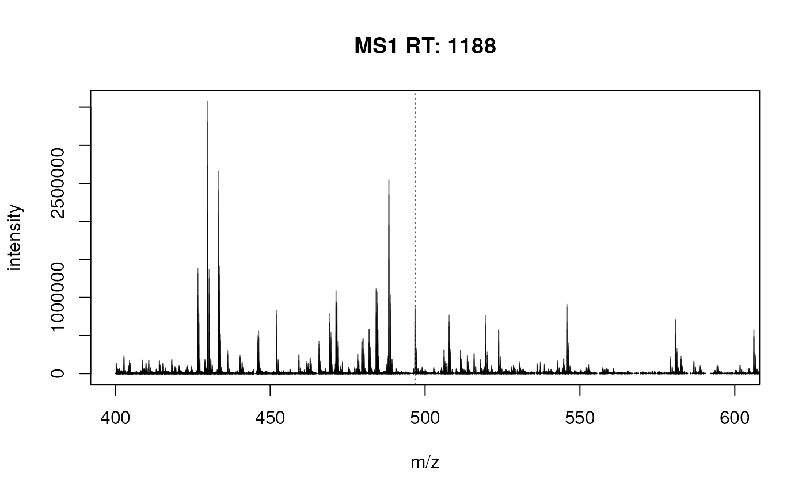
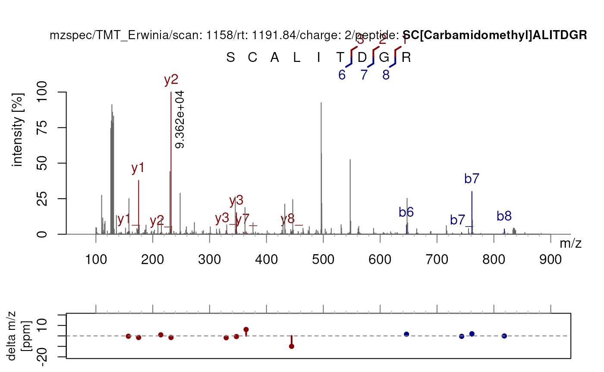
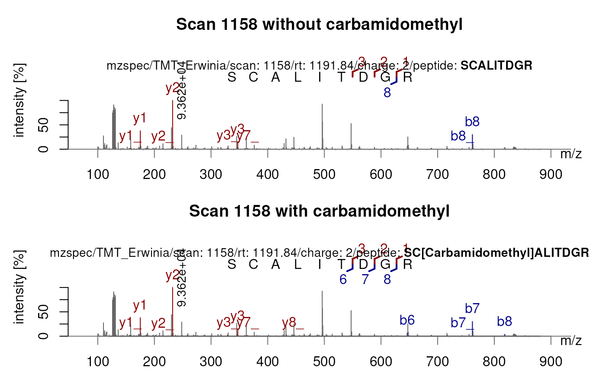

# MS2 fragment ions

**Package**:
*[PSMatch](https://bioconductor.org/packages/3.23/PSMatch)*\
**Authors**: Laurent Gatto \[aut, cre\] (ORCID:
<https://orcid.org/0000-0002-1520-2268>), Johannes Rainer \[aut\]
(ORCID: <https://orcid.org/0000-0002-6977-7147>), Sebastian Gibb \[aut\]
(ORCID: <https://orcid.org/0000-0001-7406-4443>), Samuel Wieczorek
\[ctb\], Thomas Burger \[ctb\], Guillaume Deflandre \[aut\] (ORCID:
<https://orcid.org/0009-0008-1257-2416>)\
**Last modified:** 2026-11-12 13:10:28.559227\
**Compiled**: Thu Nov 12 13:24:26 2026

## Introduction

This vignette is one among several illustrating how to use the `PSMatch`
package, focusing on the calculation and visualisation of MS2 fragment
ions. For a general overview of the package, see the `PSMatch` package
manual page
([`?PSMatch`](https://rformassspectrometry.github.io/PSMatch/reference/PSMatch.md))
and references therein.

To illustrate this vignette, we will import and merge raw and
identification data from the
*[MsDataHub](https://bioconductor.org/packages/3.23/MsDataHub)*. For
details about this section, please visit the
[Spectra](https://rformassspectrometry.github.io/Spectra/articles/Spectra.html)
package webpage.

Load the raw MS data:

``` r

spf <- MsDataHub::TMT_Erwinia_1uLSike_Top10HCD_isol2_45stepped_60min_01.20141210.mzML.gz()
library(Spectra)
sp <- Spectra(spf)
```

Load the identification data:

``` r

idf <- MsDataHub::TMT_Erwinia_1uLSike_Top10HCD_isol2_45stepped_60min_01.20141210.mzid()
```

    ## see ?MsDataHub and browseVignettes('MsDataHub') for documentation

    ## loading from cache

``` r

id <- PSM(idf) |> filterPSMs()
```

    ## Starting with 5802 PSMs:

    ## Removed 2896 decoy hits.

    ## Removed 155 PSMs with rank > 1.

    ## Removed 85 shared peptides.

    ## 2666 PSMs left.

``` r

id
```

    ## PSM with 2666 rows and 35 columns.
    ## names(35): sequence spectrumID ... subReplacementResidue subLocation

Merge both:

``` r

sp <- joinSpectraData(sp, id, by.x = "spectrumId", by.y = "spectrumID")
```

    ## Warning in joinSpectraData(sp, id, by.x = "spectrumId", by.y = "spectrumID"):
    ## Duplicates found in the 'y' key. Only last instance will be kept!

``` r

sp
```

    ## MSn data (Spectra) with 7534 spectra in a MsBackendMzR backend:
    ##        msLevel     rtime scanIndex
    ##      <integer> <numeric> <integer>
    ## 1            1    0.4584         1
    ## 2            1    0.9725         2
    ## 3            1    1.8524         3
    ## 4            1    2.7424         4
    ## 5            1    3.6124         5
    ## ...        ...       ...       ...
    ## 7530         2   3600.47      7530
    ## 7531         2   3600.83      7531
    ## 7532         2   3601.18      7532
    ## 7533         2   3601.57      7533
    ## 7534         2   3601.98      7534
    ##  ... 68 more variables/columns.
    ## 
    ## file(s):
    ## 52074d5284f_7858

In this example, we are going to focus the MS2 scan with index 1158 and
its parent MS1 scan (index 1148, selected automatically with the
[filterPrecursorScan()](https://rformassspectrometry.github.io/Spectra/reference/MsBackend.html)
function).

``` r

sp1158 <- filterPrecursorScan(sp, 1158)
```

``` r

plotSpectra(sp1158[1], xlim = c(400, 600))
abline(v = precursorMz(sp1158)[2], col = "red", lty = "dotted")
```



## Calculating fragment ions

The MS2 scan was matched to the sequence `SCALITDGR`.

``` r

sp1158$sequence
```

    ## [1] NA          "SCALITDGR"

The
[`calculateFragments()`](https://rformassspectrometry.github.io/PSMatch/reference/calculateFragments.md)
simply takes a peptide sequence as input and returns a `data.frame` with
the fragment sequences, M/Z, ion type, charge, position and the peptide
sequence of the parent ion. By default, carbamidomethylation of
cysteines is applied, but it can be turned off with the parameter
`addCarbamidomethyl = FALSE`.

``` r

calculateFragments(sp1158$sequence[2], addCarbamidomethyl = FALSE)
```

    ##           mz ion type pos z      seq   peptide
    ## 1   88.03931  b1    b   1 1        S SCALITDGR
    ## 2  191.04850  b2    b   2 1       SC SCALITDGR
    ## 3  262.08561  b3    b   3 1      SCA SCALITDGR
    ## 4  375.16967  b4    b   4 1     SCAL SCALITDGR
    ## 5  488.25373  b5    b   5 1    SCALI SCALITDGR
    ## 6  589.30141  b6    b   6 1   SCALIT SCALITDGR
    ## 7  704.32835  b7    b   7 1  SCALITD SCALITDGR
    ## 8  761.34981  b8    b   8 1 SCALITDG SCALITDGR
    ## 9  175.11895  y1    y   1 1        R SCALITDGR
    ## 10 232.14041  y2    y   2 1       GR SCALITDGR
    ## 11 347.16735  y3    y   3 1      DGR SCALITDGR
    ## 12 448.21503  y4    y   4 1     TDGR SCALITDGR
    ## 13 561.29909  y5    y   5 1    ITDGR SCALITDGR
    ## 14 674.38315  y6    y   6 1   LITDGR SCALITDGR
    ## 15 745.42026  y7    y   7 1  ALITDGR SCALITDGR
    ## 16 848.42945  y8    y   8 1 CALITDGR SCALITDGR
    ## 17 686.31778 b7_   b_   7 1  SCALITD SCALITDGR
    ## 18 743.33924 b8_   b_   8 1 SCALITDG SCALITDGR
    ## 19 329.15679 y3_   y_   3 1      DGR SCALITDGR
    ## 20 543.28853 y5_   y_   5 1    ITDGR SCALITDGR
    ## 21 656.37259 y6_   y_   6 1   LITDGR SCALITDGR
    ## 22 727.40970 y7_   y_   7 1  ALITDGR SCALITDGR
    ## 23 830.41889 y8_   y_   8 1 CALITDGR SCALITDGR
    ## 24 157.10839 y1_   y_   1 1        R SCALITDGR
    ## 25 214.12985 y2_   y_   2 1       GR SCALITDGR
    ## 26 430.20447 y4_   y_   4 1     TDGR SCALITDGR

The function also allows to generate fragment sequences with fixed
and/or variable modifications using the
[`PTMods::addFixedModifications()`](https://rdrr.io/pkg/PTMods/man/addFixedModifications.html)
and
[`PTMods::addVariableModifications()`](https://rdrr.io/pkg/PTMods/man/addVariableModifications.html)
functions from the `r BiocStyle::Biocpkg("PTMods")` package.

With variable modifications, multiple sets of fragments are generated
based on the peptide-modifications combinations available. The fragments
can be traced to their parent ion by checking the `peptide` column. A
fragment can have multiple modifications.

``` r

var_seq <- PTMods::addVariableModifications(sp1158$sequence[2],
    variableModifications = c(C = 57.02146, T = 79.966)
)

calculateFragments(var_seq)
```

    ##            mz ion type pos z      seq                       peptide
    ## 1    88.03931  b1    b   1 1        S                     SCALITDGR
    ## 2   191.04850  b2    b   2 1       SC                     SCALITDGR
    ## 3   262.08561  b3    b   3 1      SCA                     SCALITDGR
    ## 4   375.16967  b4    b   4 1     SCAL                     SCALITDGR
    ## 5   488.25373  b5    b   5 1    SCALI                     SCALITDGR
    ## 6   589.30141  b6    b   6 1   SCALIT                     SCALITDGR
    ## 7   704.32835  b7    b   7 1  SCALITD                     SCALITDGR
    ## 8   761.34981  b8    b   8 1 SCALITDG                     SCALITDGR
    ## 9   175.11895  y1    y   1 1        R                     SCALITDGR
    ## 10  232.14041  y2    y   2 1       GR                     SCALITDGR
    ## 11  347.16735  y3    y   3 1      DGR                     SCALITDGR
    ## 12  448.21503  y4    y   4 1     TDGR                     SCALITDGR
    ## 13  561.29909  y5    y   5 1    ITDGR                     SCALITDGR
    ## 14  674.38315  y6    y   6 1   LITDGR                     SCALITDGR
    ## 15  745.42026  y7    y   7 1  ALITDGR                     SCALITDGR
    ## 16  848.42945  y8    y   8 1 CALITDGR                     SCALITDGR
    ## 17  686.31778 b7_   b_   7 1  SCALITD                     SCALITDGR
    ## 18  743.33924 b8_   b_   8 1 SCALITDG                     SCALITDGR
    ## 19  329.15679 y3_   y_   3 1      DGR                     SCALITDGR
    ## 20  543.28853 y5_   y_   5 1    ITDGR                     SCALITDGR
    ## 21  656.37259 y6_   y_   6 1   LITDGR                     SCALITDGR
    ## 22  727.40970 y7_   y_   7 1  ALITDGR                     SCALITDGR
    ## 23  830.41889 y8_   y_   8 1 CALITDGR                     SCALITDGR
    ## 24  157.10839 y1_   y_   1 1        R                     SCALITDGR
    ## 25  214.12985 y2_   y_   2 1       GR                     SCALITDGR
    ## 26  430.20447 y4_   y_   4 1     TDGR                     SCALITDGR
    ## 27   88.03931  b1    b   1 1        S          SC[+57.02146]ALITDGR
    ## 28  248.06996  b2    b   2 1       SC          SC[+57.02146]ALITDGR
    ## 29  319.10707  b3    b   3 1      SCA          SC[+57.02146]ALITDGR
    ## 30  432.19113  b4    b   4 1     SCAL          SC[+57.02146]ALITDGR
    ## 31  545.27519  b5    b   5 1    SCALI          SC[+57.02146]ALITDGR
    ## 32  646.32287  b6    b   6 1   SCALIT          SC[+57.02146]ALITDGR
    ## 33  761.34981  b7    b   7 1  SCALITD          SC[+57.02146]ALITDGR
    ## 34  818.37127  b8    b   8 1 SCALITDG          SC[+57.02146]ALITDGR
    ## 35  175.11895  y1    y   1 1        R          SC[+57.02146]ALITDGR
    ## 36  232.14041  y2    y   2 1       GR          SC[+57.02146]ALITDGR
    ## 37  347.16735  y3    y   3 1      DGR          SC[+57.02146]ALITDGR
    ## 38  448.21503  y4    y   4 1     TDGR          SC[+57.02146]ALITDGR
    ## 39  561.29909  y5    y   5 1    ITDGR          SC[+57.02146]ALITDGR
    ## 40  674.38315  y6    y   6 1   LITDGR          SC[+57.02146]ALITDGR
    ## 41  745.42026  y7    y   7 1  ALITDGR          SC[+57.02146]ALITDGR
    ## 42  905.45091  y8    y   8 1 CALITDGR          SC[+57.02146]ALITDGR
    ## 43  743.33924 b7_   b_   7 1  SCALITD          SC[+57.02146]ALITDGR
    ## 44  800.36070 b8_   b_   8 1 SCALITDG          SC[+57.02146]ALITDGR
    ## 45  329.15679 y3_   y_   3 1      DGR          SC[+57.02146]ALITDGR
    ## 46  543.28853 y5_   y_   5 1    ITDGR          SC[+57.02146]ALITDGR
    ## 47  656.37259 y6_   y_   6 1   LITDGR          SC[+57.02146]ALITDGR
    ## 48  727.40970 y7_   y_   7 1  ALITDGR          SC[+57.02146]ALITDGR
    ## 49  887.44035 y8_   y_   8 1 CALITDGR          SC[+57.02146]ALITDGR
    ## 50  157.10839 y1_   y_   1 1        R          SC[+57.02146]ALITDGR
    ## 51  214.12985 y2_   y_   2 1       GR          SC[+57.02146]ALITDGR
    ## 52  430.20447 y4_   y_   4 1     TDGR          SC[+57.02146]ALITDGR
    ## 53   88.03931  b1    b   1 1        S            SCALIT[+79.966]DGR
    ## 54  191.04850  b2    b   2 1       SC            SCALIT[+79.966]DGR
    ## 55  262.08561  b3    b   3 1      SCA            SCALIT[+79.966]DGR
    ## 56  375.16967  b4    b   4 1     SCAL            SCALIT[+79.966]DGR
    ## 57  488.25373  b5    b   5 1    SCALI            SCALIT[+79.966]DGR
    ## 58  669.26741  b6    b   6 1   SCALIT            SCALIT[+79.966]DGR
    ## 59  784.29435  b7    b   7 1  SCALITD            SCALIT[+79.966]DGR
    ## 60  841.31581  b8    b   8 1 SCALITDG            SCALIT[+79.966]DGR
    ## 61  175.11895  y1    y   1 1        R            SCALIT[+79.966]DGR
    ## 62  232.14041  y2    y   2 1       GR            SCALIT[+79.966]DGR
    ## 63  347.16735  y3    y   3 1      DGR            SCALIT[+79.966]DGR
    ## 64  528.18103  y4    y   4 1     TDGR            SCALIT[+79.966]DGR
    ## 65  641.26509  y5    y   5 1    ITDGR            SCALIT[+79.966]DGR
    ## 66  754.34915  y6    y   6 1   LITDGR            SCALIT[+79.966]DGR
    ## 67  825.38626  y7    y   7 1  ALITDGR            SCALIT[+79.966]DGR
    ## 68  928.39545  y8    y   8 1 CALITDGR            SCALIT[+79.966]DGR
    ## 69  766.28378 b7_   b_   7 1  SCALITD            SCALIT[+79.966]DGR
    ## 70  823.30524 b8_   b_   8 1 SCALITDG            SCALIT[+79.966]DGR
    ## 71  329.15679 y3_   y_   3 1      DGR            SCALIT[+79.966]DGR
    ## 72  623.25453 y5_   y_   5 1    ITDGR            SCALIT[+79.966]DGR
    ## 73  736.33859 y6_   y_   6 1   LITDGR            SCALIT[+79.966]DGR
    ## 74  807.37570 y7_   y_   7 1  ALITDGR            SCALIT[+79.966]DGR
    ## 75  910.38489 y8_   y_   8 1 CALITDGR            SCALIT[+79.966]DGR
    ## 76  157.10839 y1_   y_   1 1        R            SCALIT[+79.966]DGR
    ## 77  214.12985 y2_   y_   2 1       GR            SCALIT[+79.966]DGR
    ## 78  510.17047 y4_   y_   4 1     TDGR            SCALIT[+79.966]DGR
    ## 79   88.03931  b1    b   1 1        S SC[+57.02146]ALIT[+79.966]DGR
    ## 80  248.06996  b2    b   2 1       SC SC[+57.02146]ALIT[+79.966]DGR
    ## 81  319.10707  b3    b   3 1      SCA SC[+57.02146]ALIT[+79.966]DGR
    ## 82  432.19113  b4    b   4 1     SCAL SC[+57.02146]ALIT[+79.966]DGR
    ## 83  545.27519  b5    b   5 1    SCALI SC[+57.02146]ALIT[+79.966]DGR
    ## 84  726.28887  b6    b   6 1   SCALIT SC[+57.02146]ALIT[+79.966]DGR
    ## 85  841.31581  b7    b   7 1  SCALITD SC[+57.02146]ALIT[+79.966]DGR
    ## 86  898.33727  b8    b   8 1 SCALITDG SC[+57.02146]ALIT[+79.966]DGR
    ## 87  175.11895  y1    y   1 1        R SC[+57.02146]ALIT[+79.966]DGR
    ## 88  232.14041  y2    y   2 1       GR SC[+57.02146]ALIT[+79.966]DGR
    ## 89  347.16735  y3    y   3 1      DGR SC[+57.02146]ALIT[+79.966]DGR
    ## 90  528.18103  y4    y   4 1     TDGR SC[+57.02146]ALIT[+79.966]DGR
    ## 91  641.26509  y5    y   5 1    ITDGR SC[+57.02146]ALIT[+79.966]DGR
    ## 92  754.34915  y6    y   6 1   LITDGR SC[+57.02146]ALIT[+79.966]DGR
    ## 93  825.38626  y7    y   7 1  ALITDGR SC[+57.02146]ALIT[+79.966]DGR
    ## 94  985.41691  y8    y   8 1 CALITDGR SC[+57.02146]ALIT[+79.966]DGR
    ## 95  823.30524 b7_   b_   7 1  SCALITD SC[+57.02146]ALIT[+79.966]DGR
    ## 96  880.32670 b8_   b_   8 1 SCALITDG SC[+57.02146]ALIT[+79.966]DGR
    ## 97  329.15679 y3_   y_   3 1      DGR SC[+57.02146]ALIT[+79.966]DGR
    ## 98  623.25453 y5_   y_   5 1    ITDGR SC[+57.02146]ALIT[+79.966]DGR
    ## 99  736.33859 y6_   y_   6 1   LITDGR SC[+57.02146]ALIT[+79.966]DGR
    ## 100 807.37570 y7_   y_   7 1  ALITDGR SC[+57.02146]ALIT[+79.966]DGR
    ## 101 967.40635 y8_   y_   8 1 CALITDGR SC[+57.02146]ALIT[+79.966]DGR
    ## 102 157.10839 y1_   y_   1 1        R SC[+57.02146]ALIT[+79.966]DGR
    ## 103 214.12985 y2_   y_   2 1       GR SC[+57.02146]ALIT[+79.966]DGR
    ## 104 510.17047 y4_   y_   4 1     TDGR SC[+57.02146]ALIT[+79.966]DGR

Additional parameters can alter the type of ions produced or the charge
applied in `calculateFragments`. See
[`?calculateFragments`](https://rformassspectrometry.github.io/PSMatch/reference/calculateFragments.md)
for more details on those. See the `PTMods` functions
([`?PTMods::convertAnnotation`](https://rdrr.io/pkg/PTMods/man/convertAnnotation.html),
[`?PTMods::getCanonicalSequence`](https://rdrr.io/pkg/PTMods/man/getCanonicalSequence.html),
[`?PTMods::combineModifications`](https://rdrr.io/pkg/PTMods/man/combineModifications.html))
for how to handle/apply/change the annotation style of modifications on
your sequences or check out the corresponding vignette with
`vignette("PTMods", package = "PTMods")`.

## Visualising fragment ions

We can now visualise these fragments directly on the MS spectrum. Let’s
first visualise the spectrum as is:

``` r

plotSpectra(sp1158[2])
```


[`plotSpectraPTM()`](https://rformassspectrometry.github.io/PSMatch/reference/plotSpectraPTM.md)
allows a more in depth visualisation of a PSM by providing a delta mass
plot of matched fragments and a direct visualisation of matched b- and
y-ion fragment sequences.

Labels are automatically applied based on the `sequence` defined in the
`spectraVariables`. Additionally, variable or fixed modifications such
as carbamidomethylation of cysteines can be added using the
`variableModifications` and `fixedModifications` parameters. Remember,
by default, carbamidomethylation is applied on all sequences.

``` r

dataOrigin(sp1158)[2] <- "TMT_Erwinia" ## Reduces the mzspec text
plotSpectraPTM(sp1158[2],
    fixedModifications = c(C = "Carbamidomethyl")
)
```



For instance, there is a better match when carbamidomethylation of
cysteines is applied (as above) compared to no modifications at all.

``` r

plotSpectraPTM(sp1158[2],
    variableModifications = c(C = "Carbamidomethyl"),
    addCarbamidomethyl = FALSE, ## Remove carbamidomethyl by default
    asp = 1/2,
    deltaMz = FALSE,
    main = c("Scan 1158 without carbamidomethyl", "Scan 1158 with carbamidomethyl")
)
```



As glycine has the same mass as carbamidomethylation, the b7 and b8 ions
are overlapping in both spectra.

### Customising charge states

By default,
[`plotSpectraPTM()`](https://rformassspectrometry.github.io/PSMatch/reference/plotSpectraPTM.md)
generates fragments for all charge states from 1 up to the precursor
charge. You can customise this behaviour using the `z` and `allCharges`
parameters.

The `z` parameter accepts a numeric vector with one value per spectrum,
specifying the charge state (or maximum charge state) to use. The
`allCharges` parameter controls whether to generate fragments for all
charges from 1 up to the specified value (`TRUE`, the default) or only
for the exact charge specified (`FALSE`).

``` r

## Use fragments with a custom charge state
plotSpectraPTM(sp1158[2], z = 2, allCharges = FALSE)

## Use all charges from 1 to the precursor charge state or a custom charge
plotSpectraPTM(sp1158[2], z = 2, allCharges = TRUE)
```

Note that `z` cannot be used simultaneously with
`variableModifications`.

The spectra displayed in this vignette might be overlapping due to the
restricted windows. For a better visualisation, we suggest running the
code locally.

For more details on what
[`plotSpectraPTM()`](https://rformassspectrometry.github.io/PSMatch/reference/plotSpectraPTM.md)
can do, run
[`?plotSpectraPTM`](https://rformassspectrometry.github.io/PSMatch/reference/plotSpectraPTM.md).

## License

This vignette is distributed under a [CC BY-SA
license](https://creativecommons.org/licenses/by-sa/4.0/).

## Session information

``` r

sessionInfo()
```

    ## R version 4.6.1 (2026-06-24)
    ## Platform: x86_64-pc-linux-gnu
    ## Running under: Ubuntu 24.04.4 LTS
    ## 
    ## Matrix products: default
    ## BLAS:   /usr/lib/x86_64-linux-gnu/openblas-pthread/libblas.so.3 
    ## LAPACK: /usr/lib/x86_64-linux-gnu/openblas-pthread/libopenblasp-r0.3.26.so;  LAPACK version 3.12.0
    ## 
    ## locale:
    ##  [1] LC_CTYPE=en_US.UTF-8       LC_NUMERIC=C              
    ##  [3] LC_TIME=en_US.UTF-8        LC_COLLATE=en_US.UTF-8    
    ##  [5] LC_MONETARY=en_US.UTF-8    LC_MESSAGES=en_US.UTF-8   
    ##  [7] LC_PAPER=en_US.UTF-8       LC_NAME=C                 
    ##  [9] LC_ADDRESS=C               LC_TELEPHONE=C            
    ## [11] LC_MEASUREMENT=en_US.UTF-8 LC_IDENTIFICATION=C       
    ## 
    ## time zone: UTC
    ## tzcode source: system (glibc)
    ## 
    ## attached base packages:
    ## [1] stats4    stats     graphics  grDevices utils     datasets  methods  
    ## [8] base     
    ## 
    ## other attached packages:
    ## [1] Spectra_1.23.7       BiocParallel_1.47.0  MsDataHub_1.13.3    
    ## [4] PSMatch_1.17.4       PTMods_1.1.1         S4Vectors_0.51.10   
    ## [7] BiocGenerics_0.59.12 generics_0.1.4       BiocStyle_2.41.0    
    ## 
    ## loaded via a namespace (and not attached):
    ##  [1] DBI_1.3.0                   httr2_1.3.0                
    ##  [3] rlang_1.3.0                 magrittr_2.0.5             
    ##  [5] clue_0.3-68                 otel_0.3.0                 
    ##  [7] matrixStats_1.5.0           compiler_4.6.1             
    ##  [9] RSQLite_3.53.3              png_0.1-9                  
    ## [11] systemfonts_1.3.2           vctrs_0.7.3                
    ## [13] reshape2_1.4.5              stringr_1.6.0              
    ## [15] ProtGenerics_1.45.0         pkgconfig_2.0.3            
    ## [17] MetaboCoreUtils_1.21.2      crayon_1.5.3               
    ## [19] fastmap_1.2.0               dbplyr_2.6.0               
    ## [21] XVector_0.53.0              rmarkdown_2.32             
    ## [23] ragg_1.5.2                  purrr_1.2.2                
    ## [25] bit_4.6.0                   xfun_0.62                  
    ## [27] MultiAssayExperiment_1.39.1 cachem_1.1.0               
    ## [29] jsonlite_2.0.0              blob_1.3.0                 
    ## [31] DelayedArray_0.39.8         parallel_4.6.1             
    ## [33] cluster_2.1.8.3             R6_2.6.1                   
    ## [35] bslib_0.12.0                stringi_1.8.9              
    ## [37] GenomicRanges_1.65.4        jquerylib_0.1.4            
    ## [39] Rcpp_1.1.2                  Seqinfo_1.3.2              
    ## [41] bookdown_0.48               SummarizedExperiment_1.43.0
    ## [43] knitr_1.52                  IRanges_2.47.5             
    ## [45] BiocBaseUtils_1.15.1        Matrix_1.7-6               
    ## [47] igraph_2.3.4                tidyselect_1.2.1           
    ## [49] abind_1.4-8                 yaml_2.3.12                
    ## [51] codetools_0.2-20            curl_8.1.0                 
    ## [53] lattice_0.23-1              tibble_3.3.1               
    ## [55] plyr_1.8.9                  withr_3.0.3                
    ## [57] Biobase_2.73.2              KEGGREST_1.53.6            
    ## [59] evaluate_1.0.5              desc_1.4.3                 
    ## [61] BiocFileCache_3.3.2         ExperimentHub_3.3.2        
    ## [63] Biostrings_2.81.9           pillar_1.11.1              
    ## [65] BiocManager_1.30.27         filelock_1.0.3             
    ## [67] MatrixGenerics_1.25.0       ncdf4_1.24                 
    ## [69] BiocVersion_3.23.1          glue_1.8.1                 
    ## [71] lazyeval_0.2.3              tools_4.6.1                
    ## [73] AnnotationHub_4.3.3         data.table_1.18.6.1        
    ## [75] mzR_2.47.1                  QFeatures_1.23.2           
    ## [77] fs_2.1.0                    grid_4.6.1                 
    ## [79] tidyr_1.3.2                 MsCoreUtils_1.25.4         
    ## [81] AnnotationDbi_1.75.2        cli_3.6.6                  
    ## [83] rappdirs_0.3.4              textshaping_1.0.5          
    ## [85] S4Arrays_1.13.2             dplyr_1.2.1                
    ## [87] AnnotationFilter_1.37.0     sass_0.4.10                
    ## [89] digest_0.6.39               SparseArray_1.13.4         
    ## [91] htmlwidgets_1.6.4           memoise_2.0.1              
    ## [93] htmltools_0.5.9             pkgdown_2.2.1.9000         
    ## [95] lifecycle_1.0.5             httr_1.4.9                 
    ## [97] bit64_4.8.6                 MASS_7.3-66
