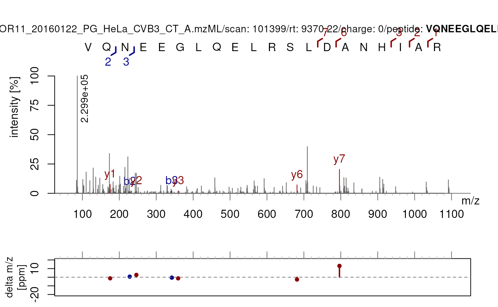
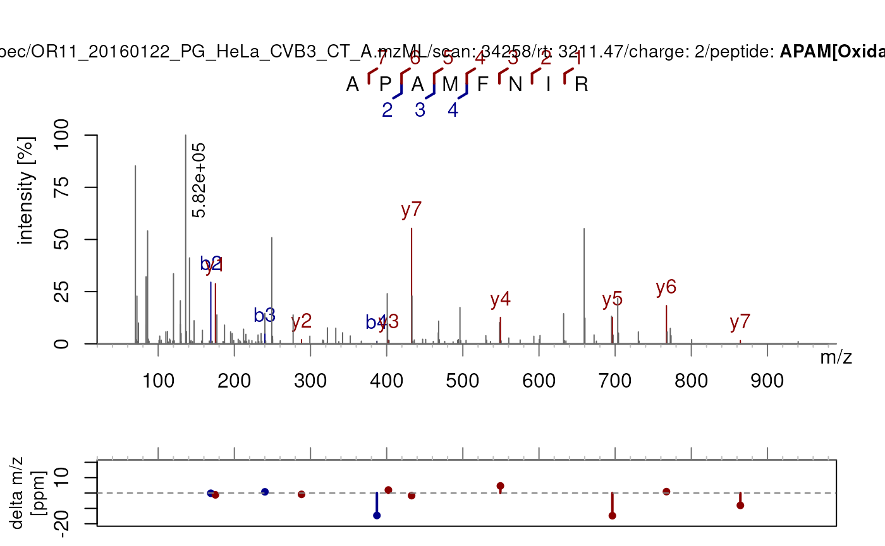

# Validate PSMs based on spectral and identification features

**Package**:
*[PSMatch](https://bioconductor.org/packages/3.24/PSMatch)*\
**Authors**: Guillaume Deflandre\
**Last modified:** 2026-11-10 23:10:39.040848\
**Compiled**: Tue Nov 10 23:35:25 2026

## Introduction

This vignette illustrates how to use the PSM validation functions in the
`PSMatch` package. The validation metrics operate on `Spectra` objects
that contain both raw peak data and peptide identification data, and
they can help assess confidence in peptide–spectrum matches (PSMs)
beyond a simple FDR filter.

The central function
[`validatePSM()`](https://rformassspectrometry.github.io/PSMatch/reference/validatePSM.md)
applies all checks at once and returns a `data.frame` summarising one
row per identified PSM. Each individual check function can also be
called in isolation when only a specific metric is needed.

## Data

### The bundled dataset

This vignette uses `psmBoekweg` and `spBoekweg`, two objects bundled
with `PSMatch`. `psmBoekweg` is a `PSM` object and `spBoekweg` is a
`Spectra` object containing the corresponding raw MS1 and MS2 spectra.
More details on these datasets can be found by loading the
*[MsDataHub](https://bioconductor.org/packages/3.24/MsDataHub)* package
and using `?Boekweg2022`.

\
[`data`](https://rdrr.io/r/utils/data.html)`(``"psmBoekweg"``)`\
[`data`](https://rdrr.io/r/utils/data.html)`(``"spBoekweg"``)`\
`psmBoekweg`

    ## PSM with 700 rows and 40 columns.
    ## Spectra: 700 unique
    ##   db: 572 target, 128 decoy
    ##   ranks: 1:700 
    ## names(40): psm_id peptide ... protein_q ms2_intensity

\
`spBoekweg`

    ## MSn data (Spectra) with 348 spectra in a MsBackendMemory backend:
    ##       msLevel     rtime scanIndex
    ##     <integer> <numeric> <integer>
    ## 1           1   941.689      6404
    ## 2           2   941.825      6405
    ## 3           1   976.998      6833
    ## 4           2   977.806      6843
    ## 5           1  1008.215      7218
    ## ...       ...       ...       ...
    ## 344         2   13980.1    138534
    ## 345         1   13980.3    138536
    ## 346         2   13981.8    138545
    ## 347         1   14171.3    139922
    ## 348         2   14173.0    139932
    ##  ... 35 more variables/columns.
    ## Processing:
    ##  Switch backend from MsBackendMzR to MsBackendMemory [Tue Nov 10 11:00:30 2026]

### Merging spectra and identification data

The two objects are joined on a shared key built from the file name and
scan number. It is important to **keep both MS1 and MS2 spectra** in the
merged object as MS1 spectra are required by
[`checkPrecursorPurity()`](https://rformassspectrometry.github.io/PSMatch/reference/validatePSM.md).

\
`psmBoekweg``$``pkey`` ``<-`` `[`paste0`](https://rdrr.io/r/base/paste.html)`(`\
`    `[`basename`](https://rdrr.io/r/base/basename.html)`(``psmBoekweg``$``filename``)``,`\
`    `[`sub`](https://rdrr.io/r/base/grep.html)`(``"^.+scan="``, ``"::"``, ``psmBoekweg``$``scannr``)`\
`)`\
`spBoekweg``$``pkey`` ``<-`` `[`paste0`](https://rdrr.io/r/base/paste.html)`(`\
`    `[`basename`](https://rdrr.io/r/base/basename.html)`(``spBoekweg``$``dataOrigin``)``,`\
`    `[`sub`](https://rdrr.io/r/base/grep.html)`(``"^.+scan="``, ``"::"``, ``spBoekweg``$``spectrumId``)`\
`)`\
\
`sp`` ``<-`` `[`joinSpectraData`](https://rdrr.io/pkg/Spectra/man/combineSpectra.html)`(``spBoekweg``, ``psmBoekweg``, by.x ``=`` ``"pkey"``)`\
`sp`

    ## MSn data (Spectra) with 348 spectra in a MsBackendMemory backend:
    ##       msLevel     rtime scanIndex
    ##     <integer> <numeric> <integer>
    ## 1           1   941.689      6404
    ## 2           2   941.825      6405
    ## 3           1   976.998      6833
    ## 4           2   977.806      6843
    ## 5           1  1008.215      7218
    ## ...       ...       ...       ...
    ## 344         2   13980.1    138534
    ## 345         1   13980.3    138536
    ## 346         2   13981.8    138545
    ## 347         1   14171.3    139922
    ## 348         2   14173.0    139932
    ##  ... 75 more variables/columns.
    ## Processing:
    ##  Switch backend from MsBackendMzR to MsBackendMemory [Tue Nov 10 11:00:30 2026]

### Adding fixed modifications

Depending on the identification data/search engines, the sequence data
might not include modifications such as carbamidomethylation of
cysteines. If need be, we can add fixed modifications by using
[`PTMods::addFixedModifications()`](https://rdrr.io/pkg/PTMods/man/addFixedModifications.html)
so that
[`calculateFragments()`](https://rformassspectrometry.github.io/PSMatch/reference/calculateFragments.md)
can account for it when computing fragment m/z values.

\
`seq_var`` ``<-`` `[`psmVariables`](https://rformassspectrometry.github.io/PSMatch/reference/PSM.md)`(``psmBoekweg``)``[[``"peptide"``]``]`\
`fdr_var`` ``<-`` `[`psmVariables`](https://rformassspectrometry.github.io/PSMatch/reference/PSM.md)`(``psmBoekweg``)``[[``"fdr"``]``]`\
\
`## In our case, carbamidomethylation is already present`\
`sp``[[``seq_var``]``]``[``!`[`is.na`](https://rdrr.io/r/base/NA.html)`(``sp``[[``seq_var``]``]``)``]``[``30``]`

    ## [1] "VGC[+57.0215]C[+57.0215]SDGIGVSR"

\
`` ## There is no need to apply `PTMods::addFixedModifications()`: ``\
`## sp[["sequence"]] <- addFixedModifications(sp[[seq_var]])`\
\
`` ## For converting the annotation style, use `PTMods::convertAnnotation()` ``\
`sp``[[``"sequence"``]``]`` ``<-`` `[`convertAnnotation`](https://rdrr.io/pkg/PTMods/man/convertAnnotation.html)`(``sp``[[``seq_var``]``]``, convertToStyle ``=`` ``"name"``)`\
`sp``[[``"sequence"``]``]``[``!`[`is.na`](https://rdrr.io/r/base/NA.html)`(``sp``[[``"sequence"``]``]``)``]``[``30``]`

    ## [1] "VGC[Carbamidomethyl]C[Carbamidomethyl]SDGIGVSR"

We also create a convenience subset containing only the identified MS2
PSMs for use with the individual check functions below.

\
`sp_psms`` ``<-`` ``sp``[``!`[`is.na`](https://rdrr.io/r/base/NA.html)`(``sp``[[``"sequence"``]``]``)`` ``&`` ``sp``$``msLevel`` ``==`` ``2L``]`

## Validation metrics

Each section below explains what a metric measures, shows how to call it
directly, and discusses how to interpret the result.

### `checkABpresence()` : a2/b2 ion pair

The a2 and b2 ions are among the smallest b-type and a-type fragments
that can be generated from a peptide. Their simultaneous presence in a
spectrum indicates good fragmentation of an actual peptide ion selected
from the MS1.

[`checkABpresence()`](https://rformassspectrometry.github.io/PSMatch/reference/validatePSM.md)
returns `TRUE` if both the **a2** and **b2** ions are matched, `FALSE`
otherwise. A `FALSE` result does not necessarily mean a bad
identification (it is not abnormal for small ions to be absent), but
`TRUE` adds confidence.

\
`ab`` ``<-`` `[`checkABpresence`](https://rformassspectrometry.github.io/PSMatch/reference/validatePSM.md)`(``sp_psms``[``1``:``100``]``)`\
[`table`](https://rdrr.io/r/base/table.html)`(``ab``)`

    ## ab
    ## FALSE  TRUE 
    ##    28    72

### `checkXYpresence()` : x2/y2 ion pair

Analogous to
[`checkABpresence()`](https://rformassspectrometry.github.io/PSMatch/reference/validatePSM.md)
but for the C-terminal x2/y2 fragment pair.

\
`xy`` ``<-`` `[`checkXYpresence`](https://rformassspectrometry.github.io/PSMatch/reference/validatePSM.md)`(``sp_psms``[``1``:``100``]``)`\
[`table`](https://rdrr.io/r/base/table.html)`(``xy``)`

    ## xy
    ## FALSE  TRUE 
    ##    97     3

### `checkOverlap()` : coverage gap between b- and y-ions

This check evaluates whether the matched b-ions and y-ions together
cover the entire peptide sequence. Given a peptide of length $`n`$, if
the highest matched b-ion index is $`b_max`$ and the highest matched
y-ion index is $`y_max`$, a gap exists when:

``` math
n - y_max > b_max
```

[`checkOverlap()`](https://rformassspectrometry.github.io/PSMatch/reference/validatePSM.md)
returns `FALSE` when such a gap is detected and `TRUE` when b- and
y-ions jointly cover the sequence with overlap.

\
`## Pre-compute label fragments once to reuse across checks`\
`frags`` ``<-`` `[`labelFragments`](https://rformassspectrometry.github.io/PSMatch/reference/labelFragments.md)`(``sp_psms``[``1``:``20``]``, type ``=`` `[`c`](https://rdrr.io/r/base/c.html)`(``"a"``, ``"b"``, ``"c"``, ``"x"``, ``"y"``, ``"z"``)``)`\
\
`overlap`` ``<-`` `[`checkOverlap`](https://rformassspectrometry.github.io/PSMatch/reference/validatePSM.md)`(``sp_psms``[``1``:``20``]``,`\
`    peptideVariable ``=`` ``"sequence"``,`\
`    fragments ``=`` ``frags``,`\
`    strippedSeq ``=`` ``PTMods``::`[`getCanonicalSequence`](https://rdrr.io/pkg/PTMods/man/getCanonicalSequence.html)`(``sp_psms``[[``"sequence"``]``]``[``1``:``20``]``)`\
`)`\
\
[`table`](https://rdrr.io/r/base/table.html)`(``overlap``)`

    ## overlap
    ## FALSE  TRUE 
    ##     4    16

**Interpretation of a gap.** A gap indicates a region of the peptide
that is not covered by any matched fragment. This often points to an
unaccounted-for modification sitting in the uncovered stretch. Consider
the sequence `sp_psms[115]$sequence`:

\
`sp_psms``[``115``]``$``sequence`

    ## [1] "VQNEEGLQELRSLDANHIAR"

\
[`checkOverlap`](https://rformassspectrometry.github.io/PSMatch/reference/validatePSM.md)`(``sp_psms``[``115``]``)`

    ## [1] FALSE

\
[`plotSpectraPTM`](https://rformassspectrometry.github.io/PSMatch/reference/plotSpectraPTM.md)`(``sp_psms``[``115``]``)`

 If the identified
sequence does not contain a modification yet
[`checkOverlap()`](https://rformassspectrometry.github.io/PSMatch/reference/validatePSM.md)
returns `FALSE`, applying a modification on one of the residues in the
identified gap *could* restore fragment coverage.

Conversely, if there are no matched fragments that include the modified
fragments in the sequence, there is no guarantee that there might have
been a modification in the first place.

There is not even a guarantee that those specific amino acids within the
gap are correct or in the correct order.

In short,
[`checkOverlap()`](https://rformassspectrometry.github.io/PSMatch/reference/validatePSM.md)
acts as a ringing bell, indicating poor coverage of matched fragments
within a spectrum and potentially revealing the need to include or
remove a modification.

### `checkShiftConsistency()` : mass shift coverage for modified sequences

When a peptide carries a post-translational modification (PTM), every
fragment ion that includes the modified residue should exhibit the
corresponding mass shift.
[`checkShiftConsistency()`](https://rformassspectrometry.github.io/PSMatch/reference/validatePSM.md)
counts how many of these shift-bearing fragment positions are actually
matched, and returns the ratio as a value between 0 and 1.

For unmodified sequences the check is not applicable and `NA` is
returned. Higher values mean more of the expected shifted fragments were
observed, which strengthens confidence in both the identification and
the modification site assignment.

\
`shifts`` ``<-`` `[`checkShiftConsistency`](https://rformassspectrometry.github.io/PSMatch/reference/validatePSM.md)`(``sp_psms``[``1``:``50``]``)`\
`## NA for unmodified sequences, numeric for modified ones`\
[`table`](https://rdrr.io/r/base/table.html)`(`[`is.na`](https://rdrr.io/r/base/NA.html)`(``shifts``)``)`

    ## 
    ## FALSE  TRUE 
    ##    10    40

\
[`summary`](https://rdrr.io/r/base/summary.html)`(``shifts``[``!`[`is.na`](https://rdrr.io/r/base/NA.html)`(``shifts``)``]``)`

    ##    Min. 1st Qu.  Median    Mean 3rd Qu.    Max. 
    ##  0.0000  0.0000  0.1214  0.1588  0.2692  0.5714

Observe that very few fragments (including a supposedly identified
modification) are matched. The highest value being NA for sequence
APAM\[Oxidation\]FNIR . Out of 7 potential sites including the
identified modification, 4 have been matched:

\
`sp_psms``[``40``]``$``sequence`

    ## [1] "APAM[Oxidation]FNIR"

\
[`checkShiftConsistency`](https://rformassspectrometry.github.io/PSMatch/reference/validatePSM.md)`(``sp_psms``[``40``]``)`

    ## [1] 0.5714286

\
[`plotSpectraPTM`](https://rformassspectrometry.github.io/PSMatch/reference/plotSpectraPTM.md)`(``sp_psms``[``40``]``)`



### `checkParentIonIntensity()` : residual precursor in the MS2 spectrum

After CID or HCD fragmentation, the precursor ion is ideally fully
fragmented. If the precursor ion still appears as an intense peak in the
MS2 spectrum, it suggests incomplete fragmentation.

[`checkParentIonIntensity()`](https://rformassspectrometry.github.io/PSMatch/reference/validatePSM.md)
reports the intensity of the matched precursor peak relative to the base
peak (most intense peak) in the spectrum. A ratio close to 0 means the
precursor was almost fully consumed; a ratio close to 1 means the
precursor dominates: a sign of poor fragmentation.

\
`parent`` ``<-`` `[`checkParentIonIntensity`](https://rformassspectrometry.github.io/PSMatch/reference/validatePSM.md)`(``sp_psms``[``1``:``50``]``)`\
[`summary`](https://rdrr.io/r/base/summary.html)`(``parent``)`

    ##    Min. 1st Qu.  Median    Mean 3rd Qu.    Max. 
    ## 0.00000 0.00000 0.00000 0.16041 0.07075 1.00000

### `checkPrecursorPurity()` : isolation window contamination

Before fragmentation, the quadrupole isolates a narrow m/z window around
the precursor ion. If other co-eluting peptides happen to fall within
this window, their fragments will contaminate the resulting MS2
spectrum, potentially leading to chimeric spectra that are harder to
interpret.

[`checkPrecursorPurity()`](https://rformassspectrometry.github.io/PSMatch/reference/validatePSM.md)
wraps
[`Spectra::precursorPurity()`](https://rdrr.io/pkg/Spectra/man/precursorPurity.html)
and computes, for each MS2 spectrum, the fraction of total signal within
the isolation window (in the preceding MS1 scan) that belongs to the
target precursor ion. A purity of 1 means no contamination; lower values
indicate co-isolated species. MS1 spectra and MS2 scans with no
preceding MS1 scan return `NA`.

Note that the full `sp` object (MS1 **and** MS2) must be passed here,
not just the PSM subset.

\
[`checkPrecursorPurity`](https://rformassspectrometry.github.io/PSMatch/reference/validatePSM.md)`(``sp``[``1``:``6``]``)`

    ## [1]       NA 1.000000       NA 0.945725       NA 1.000000

## Running all checks at once with `validatePSM()`

[`validatePSM()`](https://rformassspectrometry.github.io/PSMatch/reference/validatePSM.md)
applies all metrics in a single call. It pre-computes `peaksData` and
`labelFragments` internally to avoid redundant computation. The function
operates on a `Spectra` object that contains **both MS1 and MS2
spectra** alongside the identification data.

\
`(``res`` ``<-`` `[`validatePSM`](https://rformassspectrometry.github.io/PSMatch/reference/validatePSM.md)`(``sp``[``1``:``40``]``,`\
`                    peptideVariable ``=`` ``seq_var``,`\
`                    fdr ``=`` ``fdr_var``)`\
`)`

    ##                                        spectrumId scanIndex
    ## 1   controllerType=0 controllerNumber=1 scan=6405      6405
    ## 2   controllerType=0 controllerNumber=1 scan=6843      6843
    ## 3   controllerType=0 controllerNumber=1 scan=7219      7219
    ## 4   controllerType=0 controllerNumber=1 scan=7857      7857
    ## 5   controllerType=0 controllerNumber=1 scan=7982      7982
    ## 6   controllerType=0 controllerNumber=1 scan=8869      8869
    ## 7  controllerType=0 controllerNumber=1 scan=10217     10217
    ## 8  controllerType=0 controllerNumber=1 scan=10411     10411
    ## 9  controllerType=0 controllerNumber=1 scan=11612     11612
    ## 10 controllerType=0 controllerNumber=1 scan=12193     12193
    ## 11 controllerType=0 controllerNumber=1 scan=12840     12840
    ## 12 controllerType=0 controllerNumber=1 scan=12855     12855
    ## 13 controllerType=0 controllerNumber=1 scan=13260     13260
    ## 14 controllerType=0 controllerNumber=1 scan=14431     14431
    ## 15 controllerType=0 controllerNumber=1 scan=14934     14934
    ## 16 controllerType=0 controllerNumber=1 scan=16222     16222
    ## 17 controllerType=0 controllerNumber=1 scan=16547     16547
    ## 18 controllerType=0 controllerNumber=1 scan=16822     16822
    ## 19 controllerType=0 controllerNumber=1 scan=18978     18978
    ## 20 controllerType=0 controllerNumber=1 scan=19232     19232
    ##                       peptide      canonicalSeq          fdr  a2b2  x2y2
    ## 1               RPLEDGDQPDAKK     RPLEDGDQPDAKK 3.777505e-05 FALSE FALSE
    ## 2                KAQQELEEQTRR      KAQQELEEQTRR 3.894081e-04 FALSE FALSE
    ## 3                 VMTSGTGAPAK       VMTSGTGAPAK 1.972075e-05  TRUE FALSE
    ## 4                    TGPPMGSR          TGPPMGSR 2.828365e-03  TRUE FALSE
    ## 5                DLEADEEDTRKK      DLEADEEDTRKK 1.972075e-05  TRUE FALSE
    ## 6                    AIQLNEVR          AIQLNEVR 8.800279e-03 FALSE FALSE
    ## 7                  VIQHNALEDR        VIQHNALEDR 1.972075e-05  TRUE FALSE
    ## 8                   LTPATEPEK         LTPATEPEK 3.664146e-02 FALSE FALSE
    ## 9              MGPSGGEGMEPERR    MGPSGGEGMEPERR 1.972075e-05  TRUE FALSE
    ## 10    EEAGPM[+15.994]LAATPFVK    EEAGPMLAATPFVK 6.631032e-02 FALSE FALSE
    ## 11                  SQTVYVNEK         SQTVYVNEK 3.246838e-02  TRUE FALSE
    ## 12               ALKTISVIPGLK      ALKTISVIPGLK 1.070679e-01 FALSE FALSE
    ## 13                  LQAEAQQLR         LQAEAQQLR 1.972075e-05  TRUE FALSE
    ## 14                  VAVQGDVVR         VAVQGDVVR 3.777505e-05  TRUE FALSE
    ## 15 GILVKSTQEQSIFDM[+15.994]NR GILVKSTQEQSIFDMNR 4.317295e-02 FALSE FALSE
    ## 16          ALM[+15.994]DEVVK          ALMDEVVK 1.229773e-03  TRUE FALSE
    ## 17                  AQYEDIANR         AQYEDIANR 1.972075e-05  TRUE FALSE
    ## 18                   EGPEGFAR          EGPEGFAR 1.409294e-04  TRUE FALSE
    ## 19                HFVALSTNTTK       HFVALSTNTTK 7.291154e-05  TRUE FALSE
    ## 20                  MQELYGDGK         MQELYGDGK 1.775972e-03  TRUE  TRUE
    ##    byOverlap shiftConsistency parentIonInt precursorPurity
    ## 1       TRUE               NA   0.00000000       1.0000000
    ## 2      FALSE               NA   0.00000000       0.9457250
    ## 3       TRUE               NA   0.11204439       1.0000000
    ## 4       TRUE               NA   0.00000000       0.8622428
    ## 5       TRUE               NA   1.00000000       1.0000000
    ## 6      FALSE               NA   0.81555938       0.9384059
    ## 7       TRUE               NA   0.00000000       0.6702247
    ## 8       TRUE               NA   0.23390441       0.6416998
    ## 9       TRUE               NA   0.15843055       1.0000000
    ## 10     FALSE        0.1538462   0.00000000       1.0000000
    ## 11      TRUE               NA   0.00000000       1.0000000
    ## 12     FALSE               NA   0.07205740       0.6332377
    ## 13      TRUE               NA   0.00000000       0.5161977
    ## 14      TRUE               NA   0.00000000       1.0000000
    ## 15      TRUE        0.2500000   0.06681615       1.0000000
    ## 16      TRUE        0.1428571   0.03189541       0.8419661
    ## 17      TRUE               NA   0.00000000       0.9587410
    ## 18      TRUE               NA   0.00000000       0.7348925
    ## 19      TRUE               NA   0.00000000       0.9617097
    ## 20      TRUE               NA   0.00000000       1.0000000

The returned `data.frame` contains one row per identified PSM with the
following columns:

| Column | Type | Description |
|----|----|----|
| `spectrumId` | character | Spectrum identifier from the raw file |
| `scanIndex` | integer | Scan index within the file |
| `peptide` | character | Modified peptide sequence |
| `canonicalSeq` | character | Sequence without modifications |
| `fdr` | numeric | FDR from the database search |
| `a2b2` | logical | a2 and b2 both matched |
| `x2y2` | logical | x2 and y2 both matched |
| `byOverlap` | logical | Gap detected in b/y coverage |
| `shiftConsistency` | numeric | Fraction of shift-bearing fragments matched (`NA` if no PTM) |
| `parentIonInt` | numeric | Relative precursor intensity in MS2 |
| `precursorPurity` | numeric | Precursor isolation purity from MS1 |

Note the small size of the final dataframe in comparison with the amount
of spectra provided. This shows just how many spectra are not identified
by search engines and the importance to improve the peptide
identification in mass spectrometry-based proteomics.

### Relating metrics back to identification data

The result can be merged with the original PSM table using the spectrum
identifier or the scan index in order to include the metrics for
rescoring:

\
`## Example: join with the PSM data.frame by spectrum ID`\
`psm_df`` ``<-`` `[`as.data.frame`](https://rdrr.io/r/base/as.data.frame.html)`(``psmBoekweg``)`\
`combined`` ``<-`` `[`merge`](https://rdrr.io/pkg/S4Vectors/man/Vector-merge.html)`(``psm_df``, ``res``,`\
`    by.x ``=`` ``"scannr"``, by.y ``=`` ``"spectrumId"``,`\
`    all.x ``=`` ``FALSE`\
`)`

## License

This vignette is distributed under a [CC BY-SA
license](https://creativecommons.org/licenses/by-sa/2.0/).

## Session information

\
[`sessionInfo`](https://rdrr.io/r/utils/sessionInfo.html)`(``)`

    ## R version 4.6.1 (2026-06-24)
    ## Platform: x86_64-pc-linux-gnu
    ## Running under: Ubuntu 24.04.5 LTS
    ## 
    ## Matrix products: default
    ## BLAS:   /usr/lib/x86_64-linux-gnu/openblas-pthread/libblas.so.3 
    ## LAPACK: /usr/lib/x86_64-linux-gnu/openblas-pthread/libopenblasp-r0.3.26.so;  LAPACK version 3.12.0
    ## 
    ## locale:
    ##  [1] LC_CTYPE=en_US.UTF-8       LC_NUMERIC=C              
    ##  [3] LC_TIME=en_US.UTF-8        LC_COLLATE=en_US.UTF-8    
    ##  [5] LC_MONETARY=en_US.UTF-8    LC_MESSAGES=en_US.UTF-8   
    ##  [7] LC_PAPER=en_US.UTF-8       LC_NAME=C                 
    ##  [9] LC_ADDRESS=C               LC_TELEPHONE=C            
    ## [11] LC_MEASUREMENT=en_US.UTF-8 LC_IDENTIFICATION=C       
    ## 
    ## time zone: UTC
    ## tzcode source: system (glibc)
    ## 
    ## attached base packages:
    ## [1] stats4    stats     graphics  grDevices utils     datasets  methods  
    ## [8] base     
    ## 
    ## other attached packages:
    ## [1] Spectra_1.23.7       BiocParallel_1.47.0  PSMatch_1.17.2      
    ## [4] PTMods_1.1.1         S4Vectors_0.51.10    BiocGenerics_0.59.12
    ## [7] generics_0.1.4       BiocStyle_2.41.0    
    ## 
    ## loaded via a namespace (and not attached):
    ##  [1] SummarizedExperiment_1.43.0 xfun_0.62                  
    ##  [3] bslib_0.12.0                htmlwidgets_1.6.4          
    ##  [5] QFeatures_1.23.2            Biobase_2.73.2             
    ##  [7] lattice_0.23-1              vctrs_0.7.3                
    ##  [9] tools_4.6.1                 parallel_4.6.1             
    ## [11] tibble_3.3.1                cluster_2.1.8.3            
    ## [13] pkgconfig_2.0.3             Matrix_1.7-6               
    ## [15] data.table_1.18.6.1         desc_1.4.3                 
    ## [17] lifecycle_1.0.5             compiler_4.6.1             
    ## [19] stringr_1.6.0               textshaping_1.0.5          
    ## [21] Seqinfo_1.3.2               codetools_0.2-20           
    ## [23] clue_0.3-68                 htmltools_0.5.9            
    ## [25] sass_0.4.10                 yaml_2.3.12                
    ## [27] lazyeval_0.2.3              tidyr_1.3.2                
    ## [29] pkgdown_2.2.1.9000          pillar_1.11.1              
    ## [31] jquerylib_0.1.4             MASS_7.3-66                
    ## [33] cachem_1.1.0                DelayedArray_0.39.8        
    ## [35] MetaboCoreUtils_1.21.2      abind_1.4-8                
    ## [37] tidyselect_1.2.1            digest_0.6.39              
    ## [39] stringi_1.8.9               purrr_1.2.2                
    ## [41] dplyr_1.2.1                 reshape2_1.4.5             
    ## [43] bookdown_0.48               fastmap_1.2.0              
    ## [45] grid_4.6.1                  cli_3.6.6                  
    ## [47] SparseArray_1.13.4          magrittr_2.0.5             
    ## [49] S4Arrays_1.13.2             rmarkdown_2.32             
    ## [51] XVector_0.53.0              matrixStats_1.5.0          
    ## [53] igraph_2.3.4                otel_0.2.0                 
    ## [55] ragg_1.5.2                  evaluate_1.0.5             
    ## [57] knitr_1.52                  GenomicRanges_1.65.4       
    ## [59] IRanges_2.47.5              MultiAssayExperiment_1.39.1
    ## [61] rlang_1.3.0                 Rcpp_1.1.2                 
    ## [63] glue_1.8.1                  BiocManager_1.30.27        
    ## [65] jsonlite_2.0.0              plyr_1.8.9                 
    ## [67] AnnotationFilter_1.37.0     R6_2.6.1                   
    ## [69] MatrixGenerics_1.25.0       systemfonts_1.3.2          
    ## [71] fs_2.1.0                    ProtGenerics_1.45.0        
    ## [73] MsCoreUtils_1.25.4
